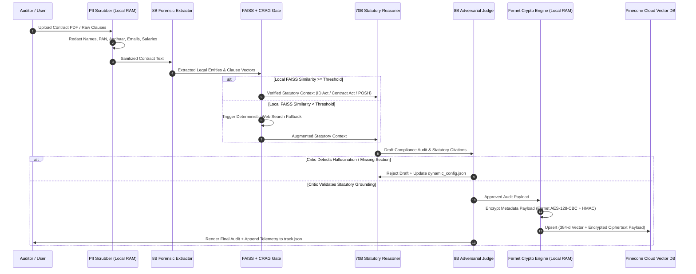
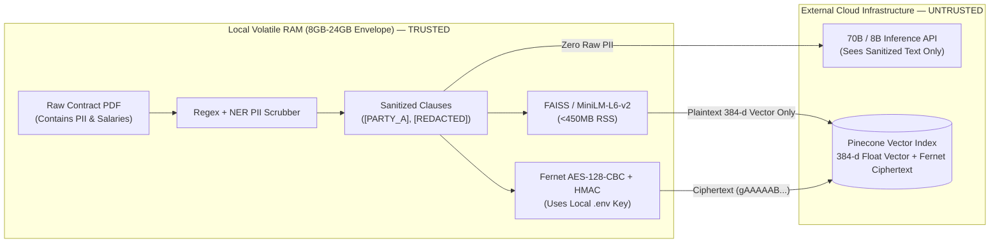
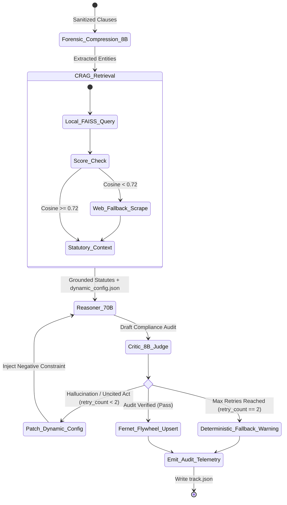

# Clause-n-Effect: Deep-Dive System Architecture & Security Specification

This document specifies the internal state transitions, cryptographic threat boundaries, and self-evolving feedback loops of **Clause-n-Effect**.

---

## 1. End-to-End Sequence & Cryptographic Boundary

The system enforces a strict separation between **Local Trusted Memory (RAM)** and **Untrusted Cloud Storage (Pinecone)**.

---

## 2. Threat Model: Vector Inversion vs. Payload Confidentiality

A common flaw in enterprise RAG systems is assuming that encrypting database disks protects vector payloads. **Clause-n-Effect** addresses two distinct threat vectors:

1. **Payload Confidentiality at Rest & in Transit (`Fernet`):**
   - Before any validated legal analysis leaves the local execution environment for Pinecone, the text metadata is encrypted using symmetric `Fernet` (`cryptography.fernet`), guaranteeing **AES-128 in CBC mode** with a **SHA256 HMAC** authentication tag.
   - If the Pinecone API key or cloud index is compromised, attackers obtain only ciphertext (`gAAAAAB...`) and cannot reconstruct the audited legal text without the local `FERNET_SECRET_KEY`.
2. **Mitigating Embedding Inversion Attacks (Upstream PII Scrubbing):**
   - Because vector similarity search requires mathematical plaintext embeddings ($v \in \mathbb{R}^{384}$ via `all-MiniLM-L6-v2`), raw embeddings remain vulnerable to gradient-based embedding inversion attacks.
   - **Defense-in-Depth:** The **PII Scrubber Node** executes *prior* to both embedding generation and LLM inference, replacing sensitive identifiers (`[PARTY_A]`, `[COMPENSATION_REDACTED]`, `[GOV_ID]`) so that neither the 384-dimensional vector nor the cloud LLM context ever encodes personally identifiable data.

---

## 3. Adversarial Actor-Critic & Self-Evolving Telemetry

To prevent open-ended retry loops and memory exhaustion on local hardware (8GB–24GB RAM ceiling):
- **Bounded Iteration Cap:** The `Router8B -> Reasoner70B -> Critic8B` cycle is strictly capped at a maximum of **2 self-correction retries** per clause batch.
- **Persistent Heuristic Evolution (`dynamic_config.json`):** When the 8B Judge flags a structural error (e.g., conflating "workman" definitions under Section 2(s) of the Industrial Disputes Act with managerial staff under the Indian Contract Act), it appends a concise negative constraint to `dynamic_config.json`, immunizing subsequent runs without fine-tuning overhead.
- **Deterministic Telemetry (`track.json`):** Records execution timestamps, token compression ratios, CRAG fallback triggers, and pass/fail verdicts for audit reproducibility.

## 4. Zero-Trust Memory Boundary (`Local RAM` vs. `Untrusted Cloud`)

---

## 5. Bounded Adversarial Actor-Critic State Machine (`stateDiagram-v2`)

